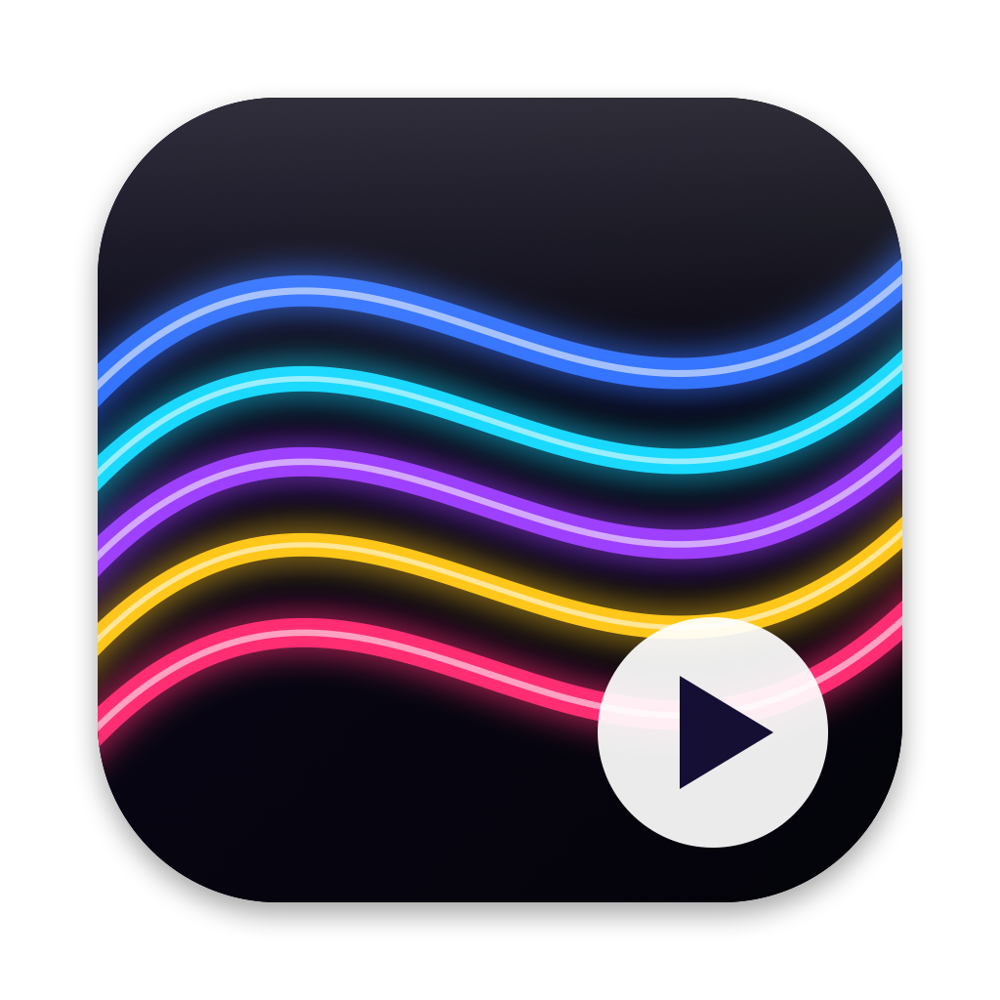
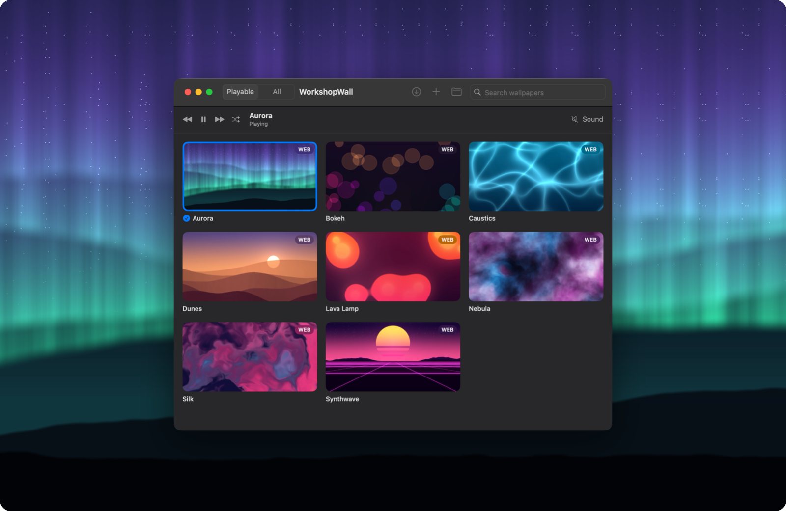
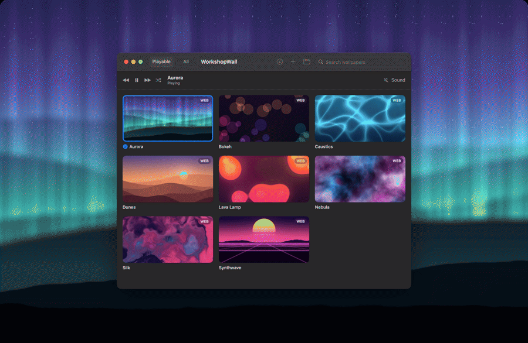
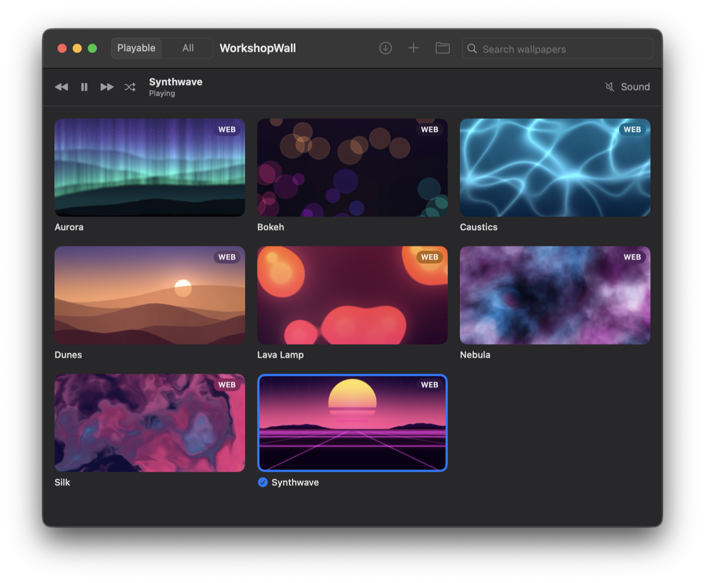
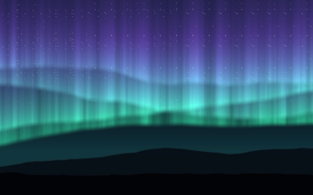
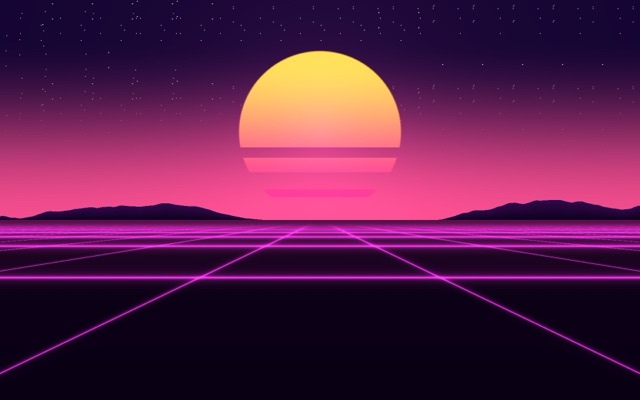
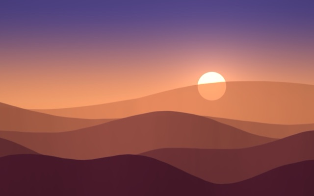
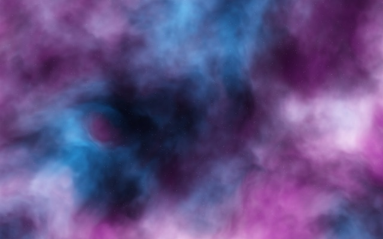
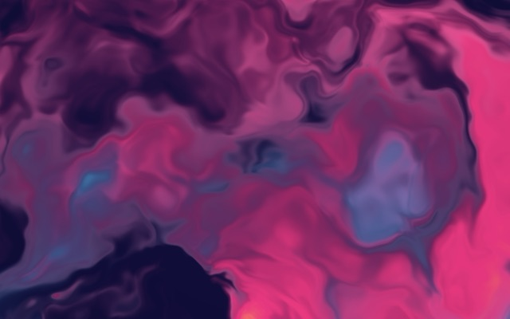

<p align="center">
  
</p>

<h1 align="center">WorkshopWall</h1>

<p align="center">
  <b>Steam Workshop wallpapers on your Mac.</b><br>
  Plays Wallpaper Engine <i>video</i> and <i>web</i> wallpapers behind your desktop icons — natively, on Apple silicon and Intel.
</p>

<p align="center">
  <a href="https://github.com/keremberkant/WorkshopWall/releases/latest"></a>
  <a href="https://github.com/keremberkant/WorkshopWall/actions/workflows/ci.yml"></a>
  
  
  
  <a href="LICENSE"></a>
</p>

<p align="center">
  <a href="#install">Install</a> ·
  <a href="#usage">Usage</a> ·
  <a href="#sample-wallpapers">Samples</a> ·
  <a href="#make-your-own-wallpaper">Make your own</a> ·
  <a href="#building-from-source">Build</a> ·
  <a href="README.tr.md">Türkçe</a>
</p>

<p align="center">
  
</p>

**WorkshopWall** is a small, open-source macOS app that brings Steam Workshop live wallpapers to your Mac. It downloads wallpapers straight from the Workshop, reads Wallpaper Engine projects directly (so the ones you already own on Windows play too), and runs them behind your desktop icons. It's written in Swift with SwiftUI and AppKit, has no dependencies and weighs about 4 MB.

> [!NOTE]
> WorkshopWall is an independent project. It is **not affiliated with** Wallpaper Engine, Kristjan Skutta or Valve, and it does not include or redistribute any Workshop content.

## Features

| Feature | |
|---|---|
| 📥 **Steam Workshop** | Paste Workshop links and download with Valve's official SteamCMD. Your password never touches the app. |
| 🎬 **Video wallpapers** | MP4 / MOV / M4V with hardware decoding. One decoder is shared by every display, so typical CPU use is 0–3 %. |
| 🌐 **Web wallpapers** | HTML / WebGL, including Wallpaper Engine's `wallpaperPropertyListener` API and the project's default user properties. |
| 🖼 **Images & GIFs** | Static and animated images, aspect-filled on every screen. |
| 🖥 **Every display, every Space** | Sits behind the desktop icons; clicks go straight through to the desktop. |
| ⏭ **Switch instantly** | Global shortcuts, previous / next / random, Dock menu, menu bar menu, or one click in the library. |
| 🔋 **Battery friendly** | Pauses when the display sleeps, on battery, in Low Power Mode, or when a full-screen or maximized window covers the desktop. Each rule can be turned off. |
| 💾 **Library anywhere** | Keep gigabytes of wallpapers on an external drive. Drag & drop folders, or import a whole Workshop folder at once. |
| 🌍 **Localized** | English and Turkish. Translations welcome. |

<p align="center">
  
</p>

### What plays and what doesn't

| Wallpaper Engine type | macOS | Notes |
|---|:---:|---|
| Video | ✅ | MP4 / MOV / M4V. WebM is not supported by macOS's video decoder. |
| Web | ✅ | Audio visualizers load but don't react to system audio. |
| Image / GIF | ✅ | |
| Scene | ❌ | A proprietary, DirectX-based format. Simple scenes can be rebuilt as web wallpapers — see [docs/converting-scenes.md](docs/converting-scenes.md). |
| Application | ❌ | Windows executables. |

## Install

1. Download **`WorkshopWall-x.y.z.zip`** from the [latest release](https://github.com/keremberkant/WorkshopWall/releases/latest) and unzip it.
2. Move **WorkshopWall.app** to **Applications**.
3. The app is open source but not notarized (that requires a paid Apple Developer ID), so the first time **right-click the app → Open → Open**.

> [!TIP]
> If macOS says the app "is damaged and can't be opened", remove the download quarantine flag and open it again:
> ```bash
> xattr -dr com.apple.quarantine "/Applications/WorkshopWall.app"
> ```

Requires **macOS 14 Sonoma** or later, on Apple silicon or Intel. Each release has a `.sha256` file next to the zip if you want to verify the download.

## Usage

<p align="center">
  
</p>

- **Add wallpapers:** drag files or folders onto the window, or click **+**. You can pick a single Wallpaper Engine project, a plain video / image / `index.html`, or the whole Workshop folder (`…/steamapps/workshop/content/431960`) to import everything at once.
- **Apply:** click a card. The blue outline and check mark show what's playing.
- **Switch:**

  | Shortcut | Action |
  |---|---|
  | <kbd>⌃</kbd> <kbd>⌥</kbd> <kbd>⌘</kbd> <kbd>→</kbd> | Next wallpaper (works in any app) |
  | <kbd>⌃</kbd> <kbd>⌥</kbd> <kbd>⌘</kbd> <kbd>←</kbd> | Previous wallpaper (works in any app) |
  | <kbd>⌃</kbd> <kbd>⌥</kbd> <kbd>⌘</kbd> <kbd>↓</kbd> | Pause / resume (works in any app) |
  | <kbd>⌘</kbd> <kbd>→</kbd> / <kbd>⌘</kbd> <kbd>←</kbd> | Next / previous (in the app) |
  | <kbd>⌥</kbd> <kbd>⌘</kbd> <kbd>R</kbd> | Random wallpaper |

  You can also right-click the Dock icon, or use the menu bar icon, for a list of all wallpapers.
- **Keep it running:** closing the window keeps the wallpaper playing. Quit from the menu bar icon or the app menu.
- **Settings** (<kbd>⌘</kbd> <kbd>,</kbd>): sound, pause rules, launch at login, menu bar icon, library folder, and optionally using the wallpaper's preview as your static desktop picture (shown on the lock screen and in Mission Control).

### Downloading from the Steam Workshop

You need a Steam account that owns Wallpaper Engine.

1. Click the **download** button in the toolbar → **Install** SteamCMD (≈ 80 MB, stored next to your library).
2. Enter your Steam user name → **Sign In to Steam…**. A Terminal window opens where you type your password and Steam Guard code **directly into SteamCMD**. You only need to do this once; SteamCMD remembers the session.
3. Paste one or more Workshop links → **Download and Add**.

Tip: filter the Workshop by *Type: Video* or *Web*. Scene items can't play, so they're removed after downloading.

## Sample wallpapers

The [`examples`](examples) folder has eight original WebGL wallpapers, each a single self-contained `index.html` that's MIT-licensed like the rest of the repo. Drag the `examples` folder onto the library window to add them all. They also work in Wallpaper Engine and in any browser.

| | | | |
|:---:|:---:|:---:|:---:|
| <a href="examples/aurora"></a><br>**Aurora** | <a href="examples/caustics"></a><br>**Caustics** | <a href="examples/synthwave"></a><br>**Synthwave** | <a href="examples/dunes"></a><br>**Dunes** |
| <a href="examples/nebula"></a><br>**Nebula** | <a href="examples/lava-lamp"></a><br>**Lava Lamp** | <a href="examples/silk"></a><br>**Silk** | <a href="examples/bokeh"></a><br>**Bokeh** |

## Make your own wallpaper

Any folder with one of these works:

- a **video** (`.mp4`, `.mov`, `.m4v`), an **image** (`.jpg`, `.png`, `.gif`, `.heic`…), or an **`index.html`**
- optionally a Wallpaper Engine–style **`project.json`** for the title and preview image:

```json
{
  "title": "My Wallpaper",
  "type": "web",
  "file": "index.html",
  "preview": "preview.jpg"
}
```

Web wallpapers run in a sandboxed WebKit view and can only read files inside their own folder. To save battery, stop animating when the app asks you to:

```js
window.wallpaperPropertyListener = {
  setPaused(paused) { /* stop or restart your requestAnimationFrame loop */ },
  applyUserProperties(props) { /* optional: Wallpaper Engine user properties */ }
};
```

The [sample wallpapers](examples) are a good starting point: copy one and edit its fragment shader. [`templates/water-waves`](templates/water-waves) is a template for turning a still image into a rippling water scene.

## Privacy & security

- **No analytics and no network requests of its own.** The network is used only when you install SteamCMD (from Valve's CDN) or download Workshop items (through SteamCMD).
- **Your Steam password is entered only in Terminal**, into Valve's SteamCMD. WorkshopWall never sees or stores it.
- **Web wallpapers are sandboxed** in WebKit's web content process and can only read files in their own folder (tested: other files in your home folder can't be read). Like in Wallpaper Engine, a web wallpaper can still use the internet, so only add wallpapers you trust.
- **No special permissions.** Global shortcuts use the Carbon hot-key API, which doesn't need Accessibility access, and the "covered desktop" check reads window bounds only, so it doesn't need Screen Recording either.

## FAQ

<details>
<summary><b>Does it use a lot of battery?</b></summary>

Videos are decoded by the media engine in hardware, once for all displays, and capped at your largest display's resolution. Everything pauses when the desktop isn't visible, when the display sleeps, on battery or in Low Power Mode (configurable in Settings). A paused wallpaper uses no CPU or GPU.
</details>

<details>
<summary><b>Why doesn't my Wallpaper Engine "Scene" play?</b></summary>

Scenes use Wallpaper Engine's own DirectX renderer and a proprietary format, so they can't be played elsewhere. Many simple scenes (one image plus a wave or shake effect) can be rebuilt as a small web wallpaper by hand; [docs/converting-scenes.md](docs/converting-scenes.md) explains how.
</details>

<details>
<summary><b>My video is a WebM file.</b></summary>

macOS can't decode WebM natively. Convert it once with `ffmpeg -i in.webm -c:v hevc_videotoolbox -tag:v hvc1 -b:v 8M out.mp4` and add the MP4.
</details>

<details>
<summary><b>Can I see the wallpaper on the lock screen?</b></summary>

macOS doesn't let apps draw on the lock screen. Turn on **Settings → Also set the preview as the static desktop picture**, and the wallpaper's still preview is used there and in Mission Control.
</details>

<details>
<summary><b>Where are my wallpapers stored?</b></summary>

In `~/Library/Application Support/WorkshopWall/Wallpapers` by default. You can choose any folder, including one on an external drive, in Settings.
</details>

## Building from source

Requirements: Xcode 15+ (Swift 5.9+) on macOS 14+.

```bash
git clone https://github.com/keremberkant/WorkshopWall.git
cd WorkshopWall
swift test                                 # unit tests
scripts/build-app.sh                       # → dist/WorkshopWall.app (universal)
scripts/build-app.sh --install             # build and copy to /Applications
VERSION=1.2.0 scripts/build-app.sh --zip   # release zip + SHA-256
```

You can also open `Package.swift` in Xcode and run the `WorkshopWall` scheme. Pushing a `v*` tag builds the universal app on GitHub Actions and attaches it to a GitHub release.

### Project layout

```
Sources/
  WorkshopWallCore/      UI-free logic (unit tested)
    Wallpaper.swift      Wallpaper Engine project.json parsing, folder discovery
    Workshop.swift       Workshop link parsing, SteamCMD output parsing
    Coverage.swift       "Is this display covered by windows?" geometry
  WorkshopWall/          the app
    App/                 entry point, settings, shared model, Dock menu, global hot keys
    Desktop/             desktop-level windows, video/web/image views, pause conditions
    Library/             wallpaper library, async thumbnail cache
    Workshop/            SteamCMD install / sign-in / download
    UI/                  SwiftUI views
Resources/             localizations (en, tr), app icon
Tests/                 XCTest suite for WorkshopWallCore
examples/              sample web wallpapers
templates/             starting points for your own wallpapers
scripts/               build-app.sh, make-icon.swift
```

### How it works

- **Desktop windows:** one borderless `NSWindow` per display at `kCGDesktopWindowLevel` (below the icons, above the system wallpaper), on all Spaces and ignoring mouse events. Windows are reused across wallpaper changes.
- **Video:** a single `AVQueuePlayer` + `AVPlayerLooper` is shared by every display, so a clip is decoded once no matter how many monitors you have. `preferredMaximumResolution` caps decoding at the largest display's size.
- **Web:** a `WKWebView` loads the project's file with read access limited to its folder. A small shim provides the Wallpaper Engine web API (`applyUserProperties`, `setPaused`, no-op audio and media listeners).
- **Pausing:** sleep and session notifications, IOKit power-source notifications, `NSProcessInfoPowerStateDidChange` for Low Power Mode, and a 2-second `CGWindowList` bounds check for covered displays.

## Contributing

Issues and pull requests are welcome; see [CONTRIBUTING.md](CONTRIBUTING.md). New sample wallpapers and translations are especially appreciated. For a translation, add `Resources/<lang>.lproj/Localizable.strings` using the English strings as keys.

## License

[MIT](LICENSE) © keremberkant.

Wallpaper Engine is a trademark of its respective owners. Steam and SteamCMD are trademarks of Valve Corporation. Screenshots show the original sample wallpapers from this repository. WorkshopWall was called *Canlı Duvar* in version 1.0; updating keeps your settings and library.
